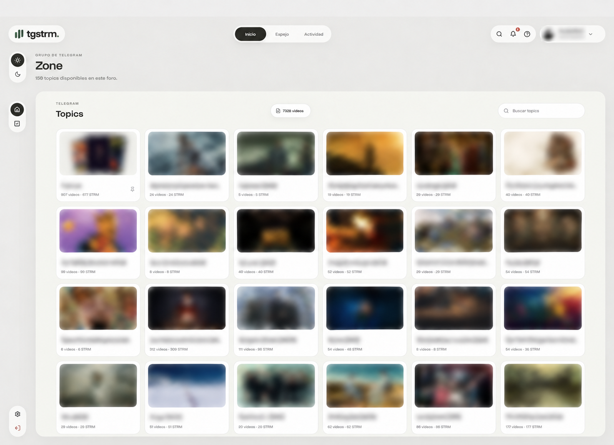

<p align="center">
  
</p>

<p align="center">
  <strong>Tu catálogo de Telegram, convertido en una biblioteca multimedia estable.</strong><br>
  Organiza, sincroniza y transforma tus vídeos de Telegram en una biblioteca lista para reproducir.<br>
  <sub>Metadatos TMDB · archivos STRM · sincronización en tiempo real</sub>
</p>

<p align="center">
  
  
  
  
  <a href="https://www.instagram.com/anubisreal/"></a>
</p>

---

## Qué hace

<p align="center">
  <strong>Tu biblioteca multimedia, construida desde Telegram.</strong><br>
  <sub>Organiza tus vídeos, identifica cada título y mantenlo listo para reproducir.</sub>
</p>

<table>
  <tr>
    <td width="33%" align="center" valign="top">
      <sub><strong>CATÁLOGO</strong></sub><br><br>
      <strong>Siempre al día.</strong><br>
      <sub>Los grupos, topics y vídeos se mantienen sincronizados con Telegram.</sub>
    </td>
    <td width="33%" align="center" valign="top">
      <sub><strong>METADATOS</strong></sub><br><br>
      <strong>Reconoce lo que guardas.</strong><br>
      <sub>TMDB aporta títulos, años, pósteres y episodios para ordenar tu colección.</sub>
    </td>
    <td width="33%" align="center" valign="top">
      <sub><strong>BIBLIOTECA</strong></sub><br><br>
      <strong>Lista para ver.</strong><br>
      <sub>Genera archivos STRM estables para reproducir tu contenido donde prefieras.</sub>
    </td>
  </tr>
</table>

<br>

<p align="center">
  
</p>

<table>
  <tr>
    <td width="33.33%" align="center">
      
    </td>
    <td width="33.33%" align="center">
      
    </td>
    <td width="33.33%" align="center">
      
    </td>
  </tr>
</table>

---

## Instalar

<p align="center">
  <strong>Portainer es la forma recomendada.</strong><br>
  <sub>Un Stack, PostgreSQL incluido y tus bibliotecas montadas desde el primer arranque.</sub>
</p>

### Portainer

1. En **Portainer → Stacks → Add stack**, elige **Git Repository** y configura:

   ```text
   Repository URL: https://github.com/AnubisReal/TgStrm.git
   Reference: main
   Compose path: compose.yaml
   ```

   Si tu copia del repositorio es privada, usa las credenciales de GitHub en Portainer.

2. En las variables del Stack, copia este bloque. Cambia las dos contraseñas y, si lo necesitas, las rutas de tu servidor:

   ```dotenv
   POSTGRES_PASSWORD=elige-una-contrasena-larga-y-unica
   TGSTRM_DATABASE_PASSWORD=elige-otra-contrasena-larga-y-unica

   TGSTRM_DATA_DIR_HOST=/instalaciones/tgstrm/data
   TGSTRM_MOVIES_DIR_HOST=/extraible2/strm/movies
   TGSTRM_SHOWS_DIR_HOST=/extraible2/strm/series
   TGSTRM_PORT=5151
   PUID=1000
   PGID=1000
   ```

   Docker crea estas carpetas si aún no existen. Elige las rutas definitivas antes del primer despliegue: ahí quedarán el estado del servidor y tu biblioteca.

3. Pulsa **Deploy the stack** y abre `http://IP_DE_TU_SERVIDOR:5151`.

4. En el primer inicio, conecta Telegram y, en el asistente de base de datos, usa:

   ```text
   Servidor: postgres
   Base de datos: tgstrm
   Usuario: tgstrm
   Contraseña: el valor de TGSTRM_DATABASE_PASSWORD
   ```

TgStrm crea y mantiene PostgreSQL dentro del Stack. La configuración, la sesión y las copias quedan en `/instalaciones/tgstrm/data`; las bibliotecas STRM permanecen en las dos rutas de películas y series. Para publicar el panel con Nginx Proxy Manager, apunta el Proxy Host a `IP_DE_TU_SERVIDOR:5151` y activa WebSocket.

### Sin Docker

Descarga el binario correspondiente desde [Releases](https://github.com/AnubisReal/TgStrm/releases), crea un directorio persistente y ejecútalo. La guía para macOS, Linux y Windows está en [docs/INSTALACION.md](docs/INSTALACION.md).
