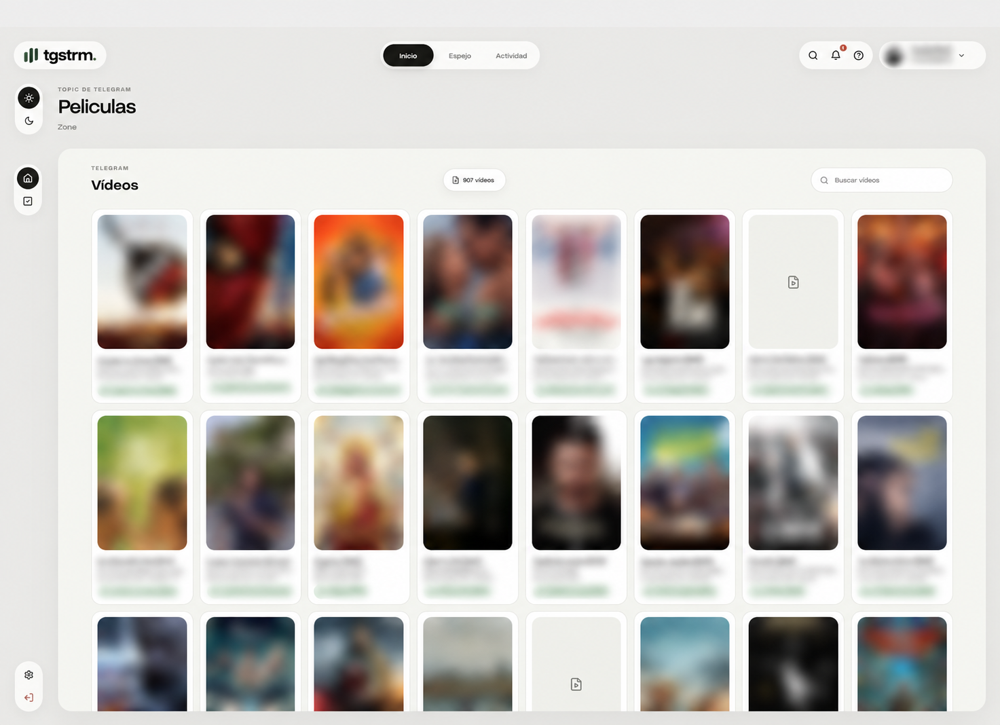
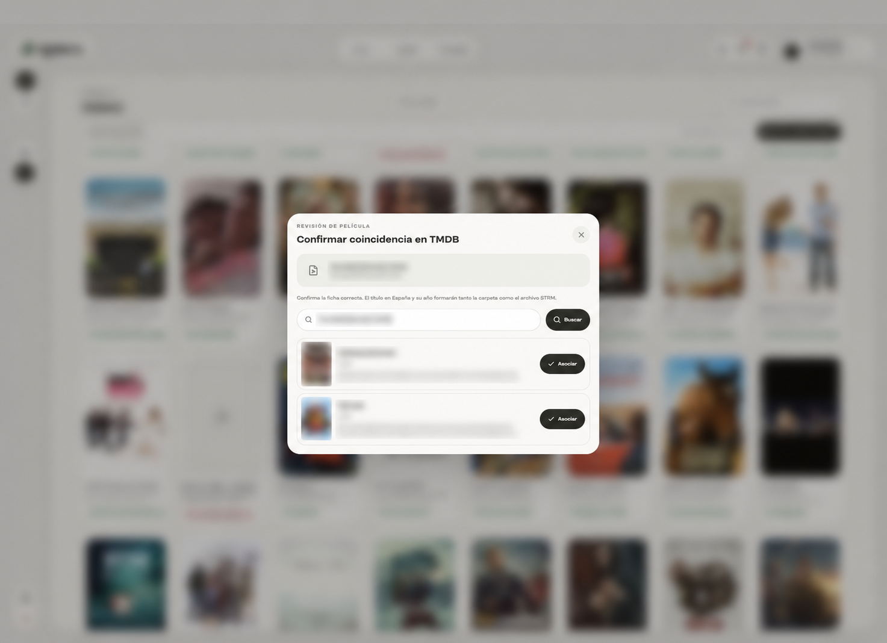
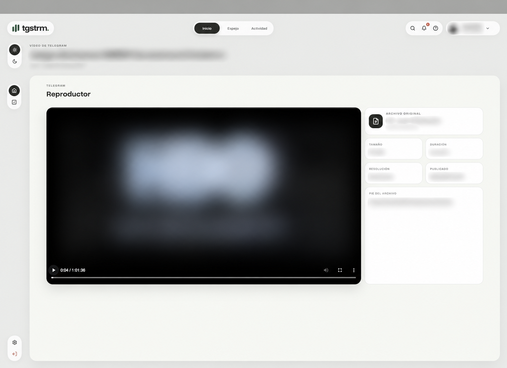

  

  <strong>Tu catálogo de Telegram, convertido en una biblioteca multimedia estable.</strong> 
  Organiza, sincroniza y transforma tus vídeos de Telegram en una biblioteca lista para reproducir. 
  Metadatos TMDB · archivos STRM · sincronización en tiempo real

  
  
  
  
  

---

## Qué hace

  <strong>Tu biblioteca multimedia, construida desde Telegram.</strong> 
  Organiza tus vídeos, identifica cada título y mantenlo listo para reproducir.

<table>
  <tr>
    <td width="33%" align="center" valign="top">
      <strong>CATÁLOGO</strong>  
      <strong>Siempre al día.</strong> 
      Los grupos, topics y vídeos se mantienen sincronizados con Telegram.
    </td>
    <td width="33%" align="center" valign="top">
      <strong>METADATOS</strong>  
      <strong>Reconoce lo que guardas.</strong> 
      TMDB aporta títulos, años, pósteres y episodios para ordenar tu colección.
    </td>
    <td width="33%" align="center" valign="top">
      <strong>BIBLIOTECA</strong>  
      <strong>Lista para ver.</strong> 
      Genera archivos STRM estables para reproducir tu contenido donde prefieras.
    </td>
  </tr>
</table>

 

  

<table>
  <tr>
    <td width="33.33%" align="center">
      
    </td>
    <td width="33.33%" align="center">
      
    </td>
    <td width="33.33%" align="center">
      
    </td>
  </tr>
</table>
